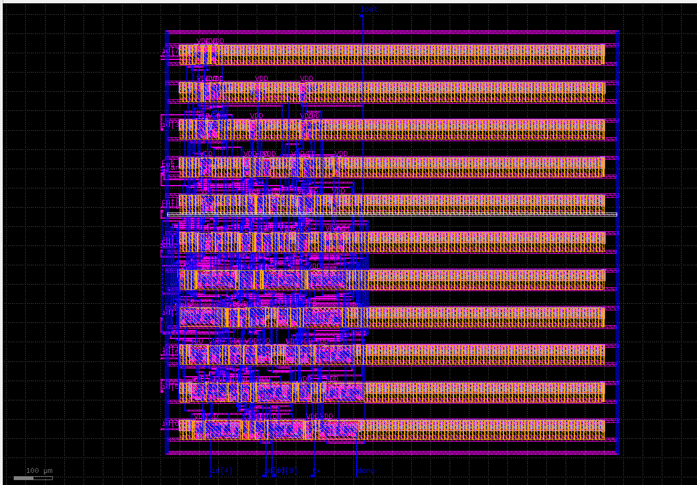
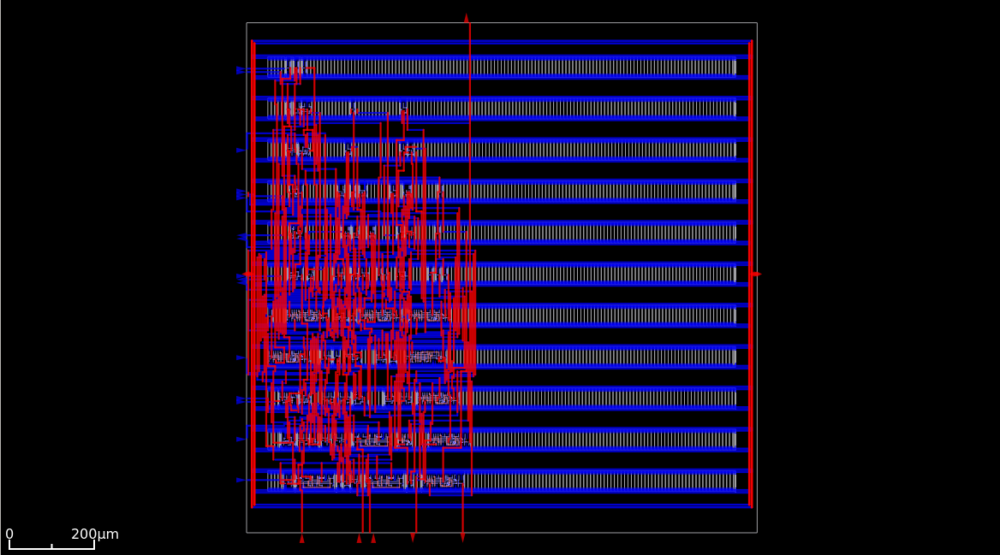
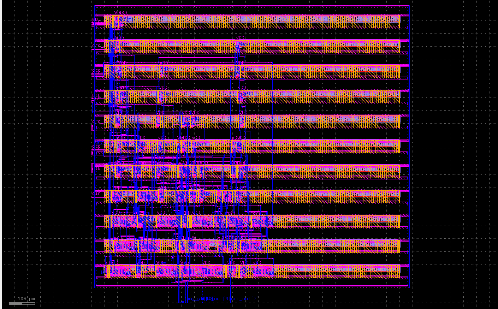
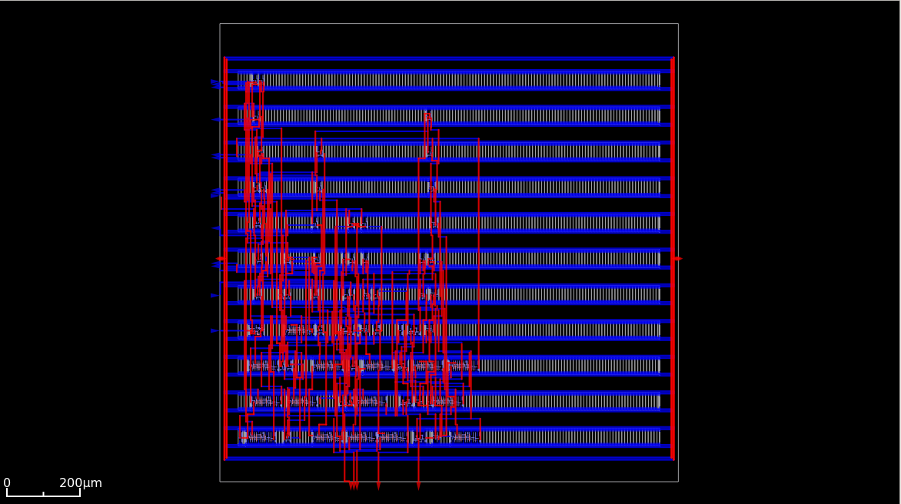
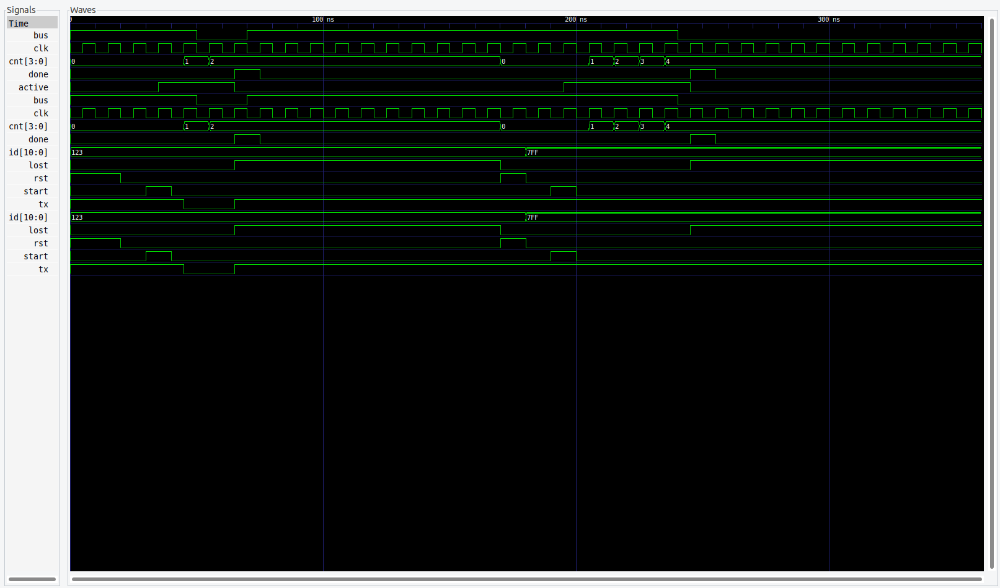
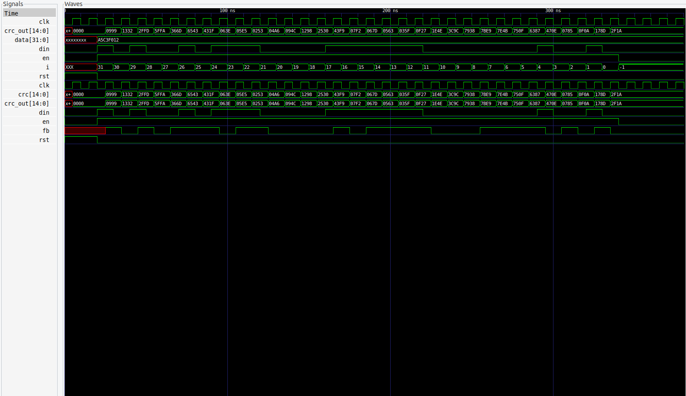
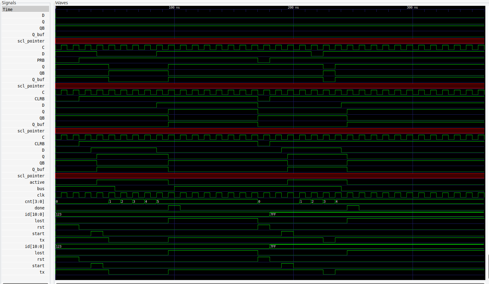
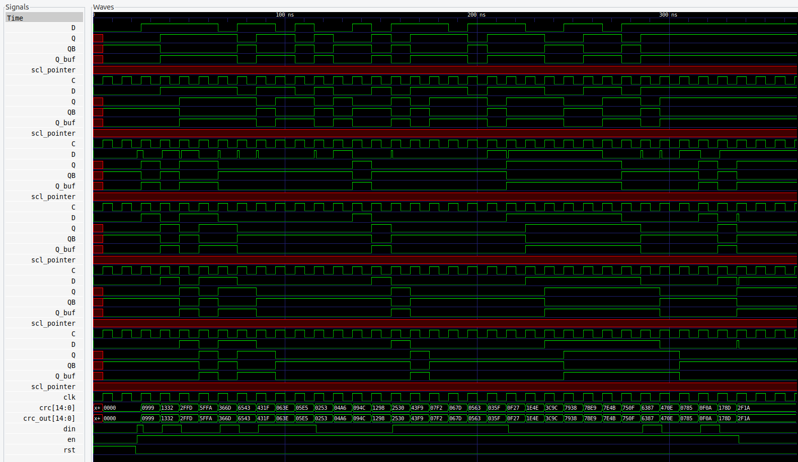
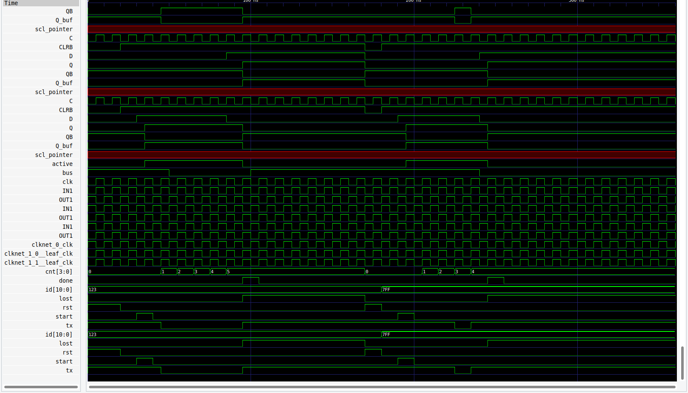

# CAN Protocol: Arbitration & CRC — RTL to GDSII

Implementation and physical design flow for two blocks of a CAN
(Controller Area Network) transmitter: bus **Arbitration** logic and
**CRC-15** generation, taken through a complete open-source
RTL-to-GDSII flow during an internship at the Semiconductor
Laboratory (SCL), Mohali.

## Scope

This covers **Arbitration and CRC only** — not a full CAN controller.
Frame Generation, Bit Stuffing, ACK Generation, Error Detection,
Receive Logic, and the APB interface are not implemented.

## Flow

RTL (Verilog) → Yosys (synthesis) → OpenROAD/OpenLane (floorplan →
PDN → placement → CTS → routing) → OpenSTA (timing) → OpenRCX
(parasitic extraction) → KLayout (GDSII)

Target: SCL 180nm-compatible standard-cell library. Note: no SCL
foundry PDK, model files, cell library files, or IO files are
included in this repo — only my own RTL, testbenches, and the
result files (netlists, reports, layout/routing images) generated
by running my design through the flow.

## Results

| Module | Cells (synth) | Flip-flops | Setup slack | Fmax |
|---|---|---|---|---|
| Arbitration | 66 | 8 | 3.08 ns (MET) | ~63 MHz |
| CRC | 21 | 15 | 11.34 ns (MET) | ~125 MHz |

Clock constraint: 50 MHz (20 ns period) for both blocks. Full timing
breakdown in [`docs/timing_tables.md`](docs/timing_tables.md) and the
raw OpenSTA reports in `docs/`.

### Placement & Routing

Placement failed to converge at an initial tighter utilization target
(likely a local congestion hotspot around the Arbitration
comparator/mux logic). Core/die area was iteratively relaxed,
settling at **50% utilization**, where placement and routing both
completed successfully.

| Arbitration Layout | Arbitration Routing |
|---|---|
|  |  |

| CRC Layout | CRC Routing |
|---|---|
|  |  |

The core area is larger than the design strictly needs (66 and 21
cells are small blocks) — a direct consequence of enlarging the core
to achieve placement convergence, not a routing failure. Routing
completed with no open nets.

### Verification

Each module was verified at RTL, post-synthesis, and post-layout
(gate-level, timing-annotated) stages using Icarus Verilog and
GTKWave.

| Stage | Arbitration | CRC |
|---|---|---|
| RTL sim |  |  |
| Post-synthesis sim |  |  |
| Post-layout sim |  |  |

## Repository structure

```
rtl/              Source Verilog (arb.v, crc.v)
testbench/        Testbenches (tb_arb.v, tb_crc.v)
synthesis/        Post-synthesis gate-level netlists (Yosys output)
post_route/       Post-route, timing-annotated netlists
docs/             Timing reports, timing_tables.md, layout/routing/waveform images
openlane_config/  OpenLane config.json for each module (targets open Sky130 PDK
                  for reproducibility — see note below)
```

## Reproducing this on an open PDK

The configs in `openlane_config/` are set up to run the same flow on
the open-source Sky130 PDK, since SCL's library can't be shared
publicly. I have not personally re-run and verified these configs —
they're provided as a starting point for reproducing the flow, not as
confirmed-working output.

## Known limitations

- DRC (poly-contact spacing) and LVS were flagged but **not fully
  closed** — scope constrained by internship timeline
- Single-corner STA only — no MCMM (multi-corner/multi-mode)
- No IR drop / electromigration signoff analysis — only considered
  qualitatively during PDN design
- No macro/hard-IP integration — standard-cell only
- Utilization (50%) was a convergence outcome of fixing placement
  failures, not an upfront area-efficiency target — not re-optimized
  upward afterward

## License

MIT — see [LICENSE](LICENSE). This covers my own RTL, testbenches,
and generated result files only; it does not grant any rights to
SCL's PDK, library, or tooling, none of which is included here.
